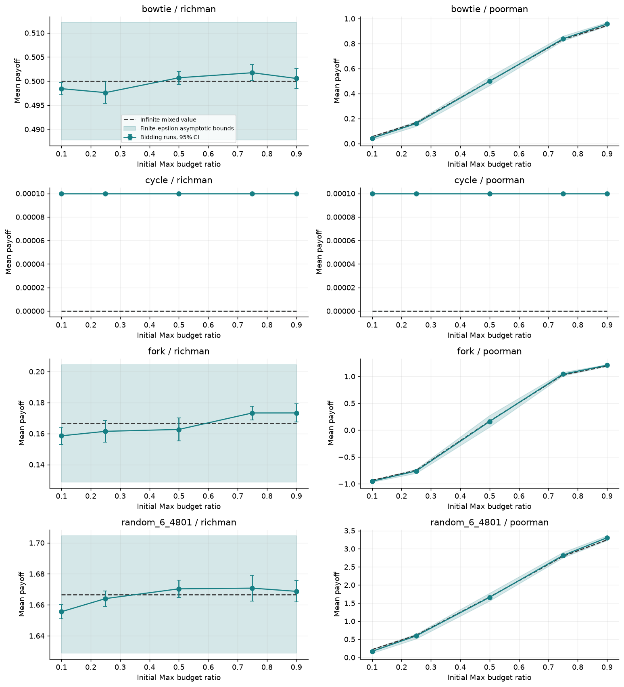
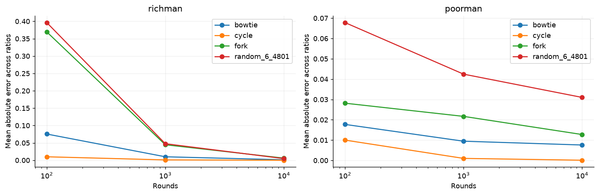
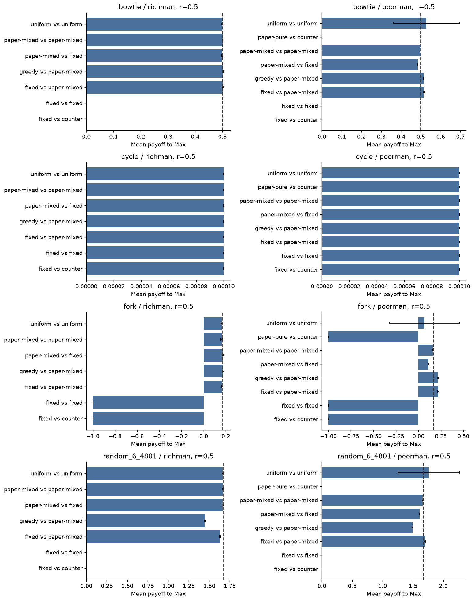

# Simulation results

Generated from `900` aggregate groups; 12 seeded replicates per condition, up to 10,000 rounds.

## Model and interpretation

Both players pay every bid. Richman transfers payments to the opponent; poorman removes them. Min wins exact ties. Rewards are the weights of vertices before each move. The statistic is the full-prefix mean, with no discarded warm-up. All graphs are strongly connected.

The dashed reference is the infinite-duration optimal mixed value, computed through the paper's random-turn equivalence. The shaded band uses the actual epsilon and reserve slack of the implemented strategies. These are asymptotic guarantees, not finite-horizon confidence bands. Error bars are 95% Student-t intervals over independent run means; rounds within a trajectory are not treated as independent samples. No multiplicity correction is applied.

Finite runs can support or fail to show predicted trends; they cannot prove an almost-sure infinite-horizon theorem. Heuristic matchups need not attain the minimax value. The pure-strategy value is Max's worst-case guarantee and is not the expected payoff of any arbitrary deterministic matchup.

## Budget sweep

| Graph | Rule | Max ratio | Observed mean | 95% CI | Mixed value | Finite-epsilon asymptotic interval |
|---|---|---:|---:|---|---:|---|
| bowtie | poorman | 0.10 | 0.04320 | [0.04260, 0.04380] | 0.05556 | [0.02944, 0.05936] |
| bowtie | poorman | 0.25 | 0.16073 | [0.15921, 0.16224] | 0.16667 | [0.13833, 0.17707] |
| bowtie | poorman | 0.50 | 0.49900 | [0.49700, 0.50100] | 0.50000 | [0.46500, 0.53500] |
| bowtie | poorman | 0.75 | 0.83873 | [0.83776, 0.83970] | 0.83333 | [0.82293, 0.86167] |
| bowtie | poorman | 0.90 | 0.95768 | [0.95669, 0.95866] | 0.94444 | [0.94064, 0.97056] |
| bowtie | richman | 0.10 | 0.49843 | [0.49714, 0.49973] | 0.50000 | [0.48780, 0.51220] |
| bowtie | richman | 0.25 | 0.49762 | [0.49542, 0.49982] | 0.50000 | [0.48780, 0.51220] |
| bowtie | richman | 0.50 | 0.50070 | [0.49938, 0.50202] | 0.50000 | [0.48780, 0.51220] |
| bowtie | richman | 0.75 | 0.50174 | [0.50005, 0.50343] | 0.50000 | [0.48780, 0.51220] |
| bowtie | richman | 0.90 | 0.50056 | [0.49848, 0.50263] | 0.50000 | [0.48780, 0.51220] |
| cycle | poorman | 0.10 | 0.00010 | [0.00010, 0.00010] | 0.00000 | [0.00000, 0.00000] |
| cycle | poorman | 0.25 | 0.00010 | [0.00010, 0.00010] | 0.00000 | [0.00000, 0.00000] |
| cycle | poorman | 0.50 | 0.00010 | [0.00010, 0.00010] | 0.00000 | [0.00000, 0.00000] |
| cycle | poorman | 0.75 | 0.00010 | [0.00010, 0.00010] | 0.00000 | [0.00000, 0.00000] |
| cycle | poorman | 0.90 | 0.00010 | [0.00010, 0.00010] | 0.00000 | [0.00000, 0.00000] |
| cycle | richman | 0.10 | 0.00010 | [0.00010, 0.00010] | 0.00000 | [0.00000, 0.00000] |
| cycle | richman | 0.25 | 0.00010 | [0.00010, 0.00010] | 0.00000 | [0.00000, 0.00000] |
| cycle | richman | 0.50 | 0.00010 | [0.00010, 0.00010] | 0.00000 | [0.00000, 0.00000] |
| cycle | richman | 0.75 | 0.00010 | [0.00010, 0.00010] | 0.00000 | [0.00000, 0.00000] |
| cycle | richman | 0.90 | 0.00010 | [0.00010, 0.00010] | 0.00000 | [0.00000, 0.00000] |
| fork | poorman | 0.10 | -0.95271 | [-0.95373, -0.95170] | -0.93511 | [-0.96794, -0.92999] |
| fork | poorman | 0.25 | -0.76116 | [-0.76402, -0.75830] | -0.74885 | [-0.80346, -0.72761] |
| fork | poorman | 0.50 | 0.16089 | [0.15509, 0.16669] | 0.16667 | [0.05761, 0.27500] |
| fork | poorman | 0.75 | 1.04307 | [1.04063, 1.04552] | 1.03079 | [1.01197, 1.07893] |
| fork | poorman | 0.90 | 1.20937 | [1.20825, 1.21049] | 1.19362 | [1.18918, 1.22209] |
| fork | richman | 0.10 | 0.15855 | [0.15299, 0.16412] | 0.16667 | [0.12869, 0.20455] |
| fork | richman | 0.25 | 0.16146 | [0.15448, 0.16844] | 0.16667 | [0.12869, 0.20455] |
| fork | richman | 0.50 | 0.16267 | [0.15518, 0.17017] | 0.16667 | [0.12869, 0.20455] |
| fork | richman | 0.75 | 0.17330 | [0.16888, 0.17772] | 0.16667 | [0.12869, 0.20455] |
| fork | richman | 0.90 | 0.17332 | [0.16755, 0.17909] | 0.16667 | [0.12869, 0.20455] |
| random_6_4801 | poorman | 0.10 | 0.16687 | [0.16408, 0.16967] | 0.21504 | [0.11569, 0.22926] |
| random_6_4801 | poorman | 0.25 | 0.59424 | [0.59183, 0.59666] | 0.61039 | [0.51318, 0.64555] |
| random_6_4801 | poorman | 0.50 | 1.65908 | [1.65120, 1.66695] | 1.66667 | [1.55808, 1.77598] |
| random_6_4801 | poorman | 0.75 | 2.81652 | [2.81123, 2.82182] | 2.79221 | [2.75258, 2.90245] |
| random_6_4801 | poorman | 0.90 | 3.30542 | [3.30248, 3.30835] | 3.24662 | [3.23000, 3.36318] |
| random_6_4801 | richman | 0.10 | 1.65555 | [1.65095, 1.66015] | 1.66667 | [1.62877, 1.70465] |
| random_6_4801 | richman | 0.25 | 1.66401 | [1.65900, 1.66902] | 1.66667 | [1.62877, 1.70465] |
| random_6_4801 | richman | 0.50 | 1.67032 | [1.66472, 1.67591] | 1.66667 | [1.62877, 1.70465] |
| random_6_4801 | richman | 0.75 | 1.67075 | [1.66246, 1.67904] | 1.66667 | [1.62877, 1.70465] |
| random_6_4801 | richman | 0.90 | 1.66870 | [1.66176, 1.67564] | 1.66667 | [1.62877, 1.70465] |

## Horizon sensitivity

Points use prefixes of the same trajectories, so estimates at different horizons are correlated. The plotted error is averaged over tested ratios and is descriptive, not a convergence proof.

## Strategy comparisons

`fixed` bids a constant fraction of remaining funds; `uniform` samples from zero to twice that amount; `greedy` uses immediate vertex weights for moves; other baselines use random-turn potential-based moves. `counter` predicts only a known deterministic bid from public state, matches it if affordable, and otherwise bids zero. It never reads a mixed strategy's realized bid.

## Random-turn controls

These independently simulated controls check the solved reference and its movement policies. They are not all-pay bidding runs.

| Graph | Rule | Ratio | Control mean | 95% CI | Reference |
|---|---|---:|---:|---|---:|
| bowtie | richman | 0.10 | 0.50173 | [0.49822, 0.50524] | 0.50000 |
| bowtie | richman | 0.25 | 0.49914 | [0.49656, 0.50172] | 0.50000 |
| bowtie | richman | 0.50 | 0.50069 | [0.49729, 0.50410] | 0.50000 |
| bowtie | richman | 0.75 | 0.50170 | [0.49829, 0.50511] | 0.50000 |
| bowtie | richman | 0.90 | 0.50008 | [0.49707, 0.50308] | 0.50000 |
| bowtie | poorman | 0.10 | 0.05482 | [0.05378, 0.05587] | 0.05556 |
| bowtie | poorman | 0.25 | 0.16709 | [0.16465, 0.16954] | 0.16667 |
| bowtie | poorman | 0.50 | 0.49913 | [0.49704, 0.50122] | 0.50000 |
| bowtie | poorman | 0.75 | 0.83427 | [0.83155, 0.83700] | 0.83333 |
| bowtie | poorman | 0.90 | 0.94328 | [0.94220, 0.94437] | 0.94444 |
| fork | richman | 0.10 | 0.16970 | [0.15736, 0.18204] | 0.16667 |
| fork | richman | 0.25 | 0.16616 | [0.15623, 0.17608] | 0.16667 |
| fork | richman | 0.50 | 0.16260 | [0.15140, 0.17380] | 0.16667 |
| fork | richman | 0.75 | 0.17082 | [0.16156, 0.18009] | 0.16667 |
| fork | richman | 0.90 | 0.16157 | [0.15075, 0.17239] | 0.16667 |
| fork | poorman | 0.10 | -0.93373 | [-0.93573, -0.93174] | -0.93511 |
| fork | poorman | 0.25 | -0.75371 | [-0.76075, -0.74667] | -0.74885 |
| fork | poorman | 0.50 | 0.17072 | [0.16332, 0.17813] | 0.16667 |
| fork | poorman | 0.75 | 1.02758 | [1.02392, 1.03125] | 1.03079 |
| fork | poorman | 0.90 | 1.19392 | [1.19186, 1.19599] | 1.19362 |
| random_6_4801 | richman | 0.10 | 1.65645 | [1.65016, 1.66274] | 1.66667 |
| random_6_4801 | richman | 0.25 | 1.67688 | [1.66584, 1.68791] | 1.66667 |
| random_6_4801 | richman | 0.50 | 1.65983 | [1.64947, 1.67018] | 1.66667 |
| random_6_4801 | richman | 0.75 | 1.66598 | [1.65658, 1.67539] | 1.66667 |
| random_6_4801 | richman | 0.90 | 1.66987 | [1.66032, 1.67941] | 1.66667 |
| random_6_4801 | poorman | 0.10 | 0.21553 | [0.20905, 0.22201] | 0.21504 |
| random_6_4801 | poorman | 0.25 | 0.61670 | [0.60456, 0.62884] | 0.61039 |
| random_6_4801 | poorman | 0.50 | 1.66888 | [1.65651, 1.68126] | 1.66667 |
| random_6_4801 | poorman | 0.75 | 2.79378 | [2.78564, 2.80191] | 2.79221 |
| random_6_4801 | poorman | 0.90 | 3.24472 | [3.23684, 3.25261] | 3.24662 |
| cycle | richman | 0.10 | 0.00010 | [0.00010, 0.00010] | 0.00000 |
| cycle | richman | 0.25 | 0.00010 | [0.00010, 0.00010] | 0.00000 |
| cycle | richman | 0.50 | 0.00010 | [0.00010, 0.00010] | 0.00000 |
| cycle | richman | 0.75 | 0.00010 | [0.00010, 0.00010] | 0.00000 |
| cycle | richman | 0.90 | 0.00010 | [0.00010, 0.00010] | 0.00000 |
| cycle | poorman | 0.10 | 0.00010 | [0.00010, 0.00010] | 0.00000 |
| cycle | poorman | 0.25 | 0.00010 | [0.00010, 0.00010] | 0.00000 |
| cycle | poorman | 0.50 | 0.00010 | [0.00010, 0.00010] | 0.00000 |
| cycle | poorman | 0.75 | 0.00010 | [0.00010, 0.00010] | 0.00000 |
| cycle | poorman | 0.90 | 0.00010 | [0.00010, 0.00010] | 0.00000 |

## Deterministic guarantees and counterstrategies

A matching counter defeats fixed deterministic Richman bids after at most finitely many Max wins. Under poorman payments, a richer Max can still obtain a positive guarantee. Matching is an admissible opponent, but need not be the worst counterstrategy when Max is richer; a payoff above the sure reference does not contradict it.

| Graph | Rule | Ratio | Max strategy | Observed mean | Pure reference | Implemented lower target |
|---|---|---:|---|---:|---:|---|
| bowtie | poorman | 0.10 | fixed | 0.00010 | 0.00000 | baseline |
| bowtie | poorman | 0.10 | paper-pure | 0.00010 | 0.00000 | 0.00000 |
| bowtie | poorman | 0.25 | fixed | 0.00010 | 0.00000 | baseline |
| bowtie | poorman | 0.25 | paper-pure | 0.00010 | 0.00000 | 0.00000 |
| bowtie | poorman | 0.50 | fixed | 0.00010 | 0.00000 | baseline |
| bowtie | poorman | 0.50 | paper-pure | 0.00010 | 0.00000 | 0.00000 |
| bowtie | poorman | 0.75 | fixed | 0.99400 | 0.66667 | baseline |
| bowtie | poorman | 0.75 | paper-pure | 0.64270 | 0.66667 | 0.64883 |
| bowtie | poorman | 0.90 | fixed | 0.99530 | 0.88889 | baseline |
| bowtie | poorman | 0.90 | paper-pure | 0.87120 | 0.88889 | 0.88162 |
| bowtie | richman | 0.10 | fixed | 0.00010 | 0.00000 | baseline |
| bowtie | richman | 0.25 | fixed | 0.00010 | 0.00000 | baseline |
| bowtie | richman | 0.50 | fixed | 0.00010 | 0.00000 | baseline |
| bowtie | richman | 0.75 | fixed | 0.00010 | 0.00000 | baseline |
| bowtie | richman | 0.90 | fixed | 0.00010 | 0.00000 | baseline |
| cycle | poorman | 0.10 | fixed | 0.00010 | 0.00000 | baseline |
| cycle | poorman | 0.10 | paper-pure | 0.00010 | 0.00000 | 0.00000 |
| cycle | poorman | 0.25 | fixed | 0.00010 | 0.00000 | baseline |
| cycle | poorman | 0.25 | paper-pure | 0.00010 | 0.00000 | 0.00000 |
| cycle | poorman | 0.50 | fixed | 0.00010 | 0.00000 | baseline |
| cycle | poorman | 0.50 | paper-pure | 0.00010 | 0.00000 | 0.00000 |
| cycle | poorman | 0.75 | fixed | 0.00010 | 0.00000 | baseline |
| cycle | poorman | 0.75 | paper-pure | 0.00010 | 0.00000 | 0.00000 |
| cycle | poorman | 0.90 | fixed | 0.00010 | 0.00000 | baseline |
| cycle | poorman | 0.90 | paper-pure | 0.00010 | 0.00000 | 0.00000 |
| cycle | richman | 0.10 | fixed | 0.00010 | 0.00000 | baseline |
| cycle | richman | 0.25 | fixed | 0.00010 | 0.00000 | baseline |
| cycle | richman | 0.50 | fixed | 0.00010 | 0.00000 | baseline |
| cycle | richman | 0.75 | fixed | 0.00010 | 0.00000 | baseline |
| cycle | richman | 0.90 | fixed | 0.00010 | 0.00000 | baseline |
| fork | poorman | 0.10 | fixed | -0.99990 | -1.00000 | baseline |
| fork | poorman | 0.10 | paper-pure | -0.99990 | -1.00000 | -1.00000 |
| fork | poorman | 0.25 | fixed | -0.99990 | -1.00000 | baseline |
| fork | poorman | 0.25 | paper-pure | -0.99990 | -1.00000 | -1.00000 |
| fork | poorman | 0.50 | fixed | -0.99990 | -1.00000 | baseline |
| fork | poorman | 0.50 | paper-pure | -0.99990 | -1.00000 | -1.00000 |
| fork | poorman | 0.75 | fixed | 1.24250 | 0.65714 | baseline |
| fork | poorman | 0.75 | paper-pure | 0.58250 | 0.65714 | 0.60888 |
| fork | poorman | 0.90 | fixed | 1.24465 | 1.12087 | baseline |
| fork | poorman | 0.90 | paper-pure | 1.05630 | 1.12087 | 1.11009 |
| fork | richman | 0.10 | fixed | -0.99990 | -1.00000 | baseline |
| fork | richman | 0.25 | fixed | -0.99990 | -1.00000 | baseline |
| fork | richman | 0.50 | fixed | -0.99990 | -1.00000 | baseline |
| fork | richman | 0.75 | fixed | -0.99990 | -1.00000 | baseline |
| fork | richman | 0.90 | fixed | -0.99990 | -1.00000 | baseline |
| random_6_4801 | poorman | 0.10 | fixed | 0.00000 | -0.00000 | baseline |
| random_6_4801 | poorman | 0.10 | paper-pure | 0.00000 | -0.00000 | -0.00000 |
| random_6_4801 | poorman | 0.25 | fixed | 0.00000 | -0.00000 | baseline |
| random_6_4801 | poorman | 0.25 | paper-pure | 0.00000 | -0.00000 | -0.00000 |
| random_6_4801 | poorman | 0.50 | fixed | 0.00000 | -0.00000 | baseline |
| random_6_4801 | poorman | 0.50 | paper-pure | 0.00000 | -0.00000 | -0.00000 |
| random_6_4801 | poorman | 0.75 | fixed | 3.47650 | 2.20000 | baseline |
| random_6_4801 | poorman | 0.75 | paper-pure | 2.10500 | 2.20000 | 2.14092 |
| random_6_4801 | poorman | 0.90 | fixed | 3.47620 | 3.01176 | baseline |
| random_6_4801 | poorman | 0.90 | paper-pure | 2.91140 | 3.01176 | 2.98225 |
| random_6_4801 | richman | 0.10 | fixed | 0.00000 | -0.00000 | baseline |
| random_6_4801 | richman | 0.25 | fixed | 0.00000 | -0.00000 | baseline |
| random_6_4801 | richman | 0.50 | fixed | 0.00000 | -0.00000 | baseline |
| random_6_4801 | richman | 0.75 | fixed | 0.00000 | -0.00000 | baseline |
| random_6_4801 | richman | 0.90 | fixed | 0.00000 | -0.00000 | baseline |

## Numerical checks and limitations

Unresolved numerical failures: **0**. High-precision restarts: **72**. Float range failures trigger a complete restart with 80-digit Decimal monetary arithmetic and the same seed; `precision_retries.csv` records why. `runs.csv` records precision and log budgets. Only unresolved failures are omitted, in full; any such omissions must be investigated before drawing conclusions.

Budgets are rescaled by a common factor after every round, preserving bid comparisons for the included scale-invariant strategies. The natural log of the physical total tracks poorman depletion without adding money. No bid floor, rounded cents, horizon-based spending schedule, or budget replenishment is used. Decimal fallback greatly extends monetary range; its precision, potential calculations, and random samples are still finite approximations.

The Bellman solver stops only when its lower/upper value bounds differ by at most 1e-10. All graph weights and strategies are recorded. The RNG seed and parameters of every replicate are in `runs.csv`; package versions and source hashes are in `manifest.json`.

## Files

- `runs.csv`: individual bidding runs at each horizon.
- `summary.csv`: run-mean statistics and theory comparisons.
- `traces.csv`: sampled round-level trajectories for the first paper-strategy replicate at ratio 0.5.
- `random_turn_controls.csv`: independent control simulations.
- `config.json`, `graphs.json`, `manifest.json`: reproduction metadata.
- Figures are available as PNG and vector PDF.

## Reference

Guy Avni, Ismaël Jecker, and Đorđe Žikelić. *Infinite-Duration All-Pay Bidding Games*. SODA 2021, pp. 617–636. [Published paper](https://doi.org/10.1137/1.9781611976465.38); [full preprint](https://arxiv.org/abs/2005.06636). See `docs/METHODOLOGY.md` in the project for equations and implementation mapping.
